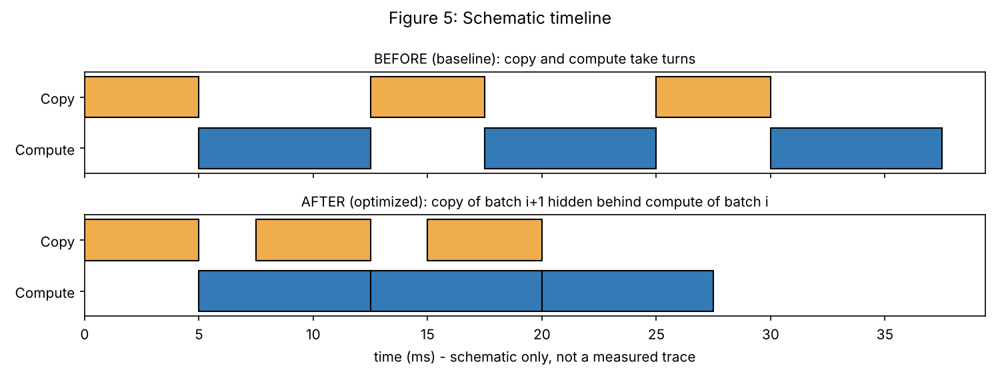
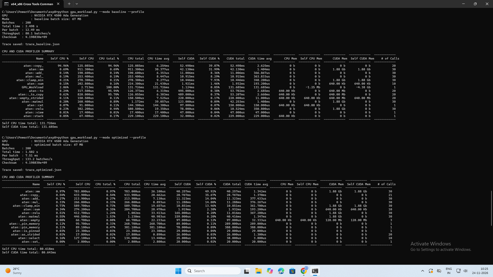
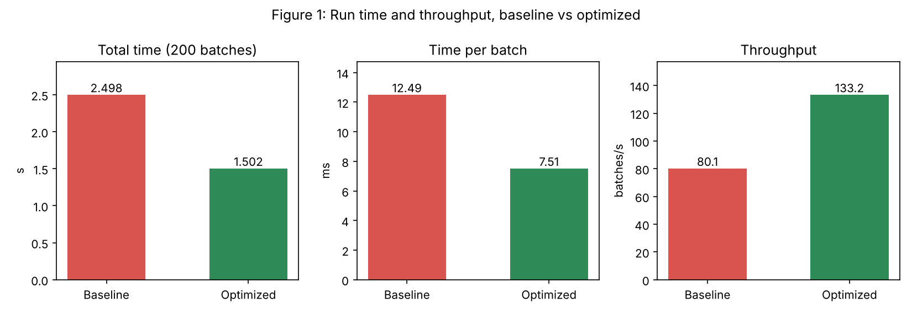
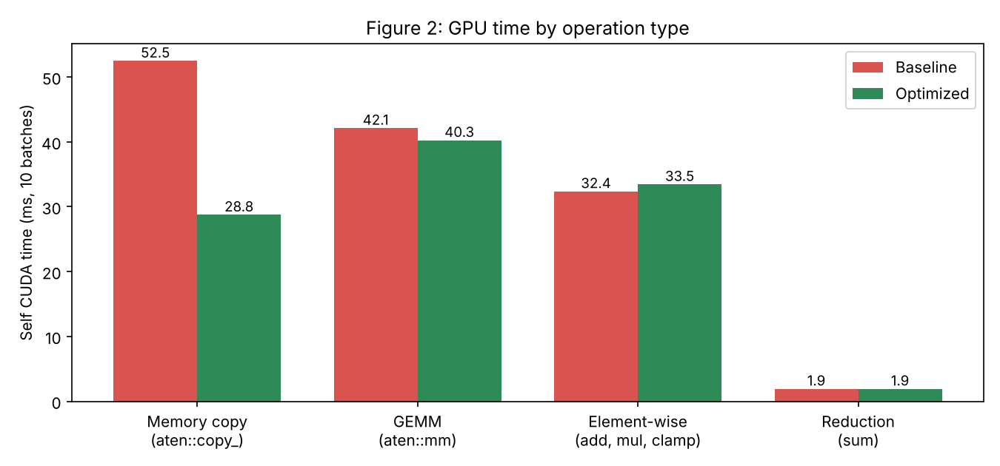
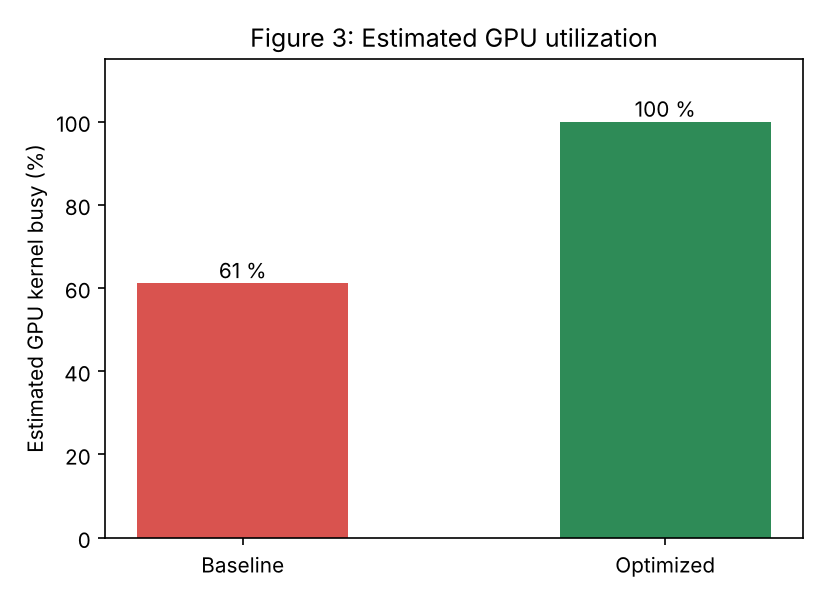
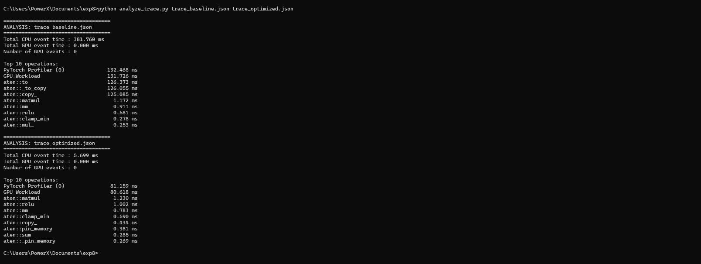
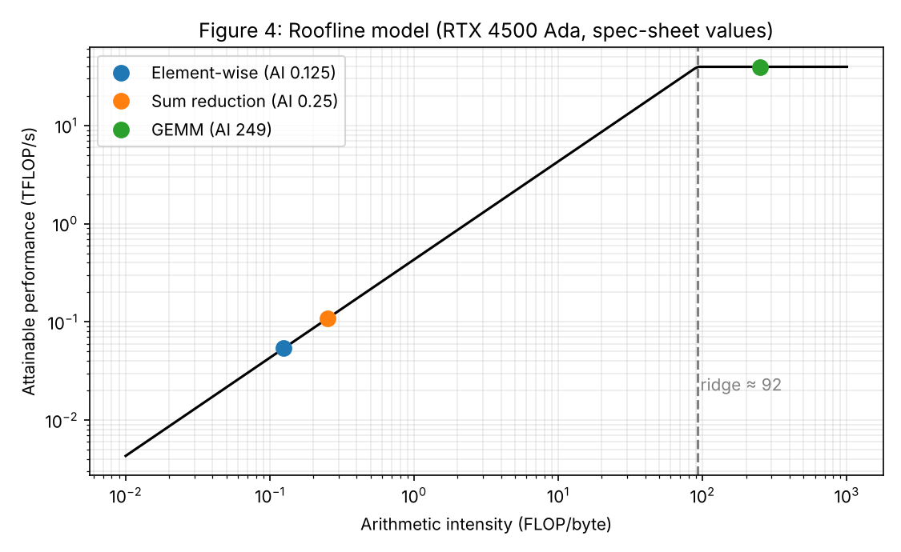

# Profiling and GPU Utilization

This repository contains the code, results, graphs and report for profiling a GPU workload, finding where time is lost, and improving GPU utilization by overlapping data transfer with computation.

---

## Table of Contents

1. [Aim](#1-aim)
2. [Learning Outcomes](#2-learning-outcomes)
3. [Background](#3-background)
4. [Repository Structure](#4-repository-structure)
5. [Setup](#5-setup)
6. [Procedure](#6-procedure)
7. [Results](#7-results)
8. [Kernel Classification (Compute-bound vs Memory-bound)](#8-kernel-classification-compute-bound-vs-memory-bound)
9. [Bottlenecks Found and Fixes Applied](#9-bottlenecks-found-and-fixes-applied)
10. [Conclusion](#10-conclusion)


---

## 1. Aim

To profile a GPU workload to find where time is lost, and to improve GPU utilization by overlapping data transfer (copy) with computation.

## 2. Learning Outcomes

- Capture a timeline of a GPU program and identify idle GPU gaps and host-device data transfers.
- Classify each kernel as compute-bound or memory-bound using arithmetic intensity.
- Apply pinned host memory and two CUDA streams to overlap copy with compute.
- Quantify the improvement using GPU utilization and total run time.

## 3. Background

**GPU utilization.** A GPU is useful only while a kernel is running. Time spent waiting for data, for the CPU, or for a previous step is idle time. Because GPU jobs are billed by the hour, idle time is wasted money.

**Where time is lost.** In a simple program, every batch does: copy to GPU, run kernels, copy the result back. Each step waits for the previous one. While the copy engine moves data, the compute units are idle, and while kernels run, the copy engine is idle.

**Pageable vs pinned memory.** Normal host memory is *pageable*: the operating system may move it, so the driver first copies it into a hidden pinned staging buffer and then transfers it to the GPU by DMA. This is slower and cannot be asynchronous. *Pinned (page-locked)* memory can be read directly by the GPU's DMA engine, is faster, and allows `non_blocking=True` copies that return immediately.

**CUDA streams.** Work in one stream runs in order. Work in different streams may run at the same time. With a copy stream and a compute stream, the copy of batch *i+1* can run while the kernels process batch *i*. Two device buffers (double buffering) and CUDA events keep the two streams correct.

**Compute-bound vs memory-bound.** Arithmetic Intensity (AI) = FLOPs performed / bytes moved from GPU memory. The GPU's *ridge point* = peak FLOP/s / peak memory bandwidth. If AI is above the ridge point, the kernel is compute-bound; if below, it is memory-bound.



*Figure 5 is a schematic of the idea. It is not a measured trace.*

## 4. Repository Structure

```
.
├── README.md
├── requirements.txt
├── .gitignore
├── src/
│   ├── gpu_workload.py      # baseline and optimized workload
│   ├── analyze_trace.py     # trace analyzer (utilization, idle gaps, overlap)
│   └── make_charts.py       # generates the graphs in results/
├── images/
│   ├── 01_baseline_vs_optimized_run.png   # terminal screenshot of both runs
│   └── 02_analyze_trace_output.png        # terminal screenshot of analyze_trace.py
├── results/
│   ├── fig1_time_throughput.png
│   ├── fig2_cuda_time_breakdown.png
│   ├── fig3_gpu_utilization_estimate.png
│   ├── fig4_roofline.png
│   └── fig5_schematic_timeline.png
```

## 5. Setup

| Item | Details |
|---|---|
| GPU | NVIDIA RTX 4500 Ada Generation |
| Operating system | Windows (x64 Cross Tools command prompt) |
| Framework | PyTorch with CUDA, `torch.profiler` |
| Workload | 200 batches, each 16384 × 1024 floats (67 MB), `--reps 3` |
| Profiled run | 10 batches (`--profile-batches 10`) |
| Tools used | `gpu_workload.py`, `analyze_trace.py`, PyTorch Profiler |
| Optional tools | `nvidia-smi`, Nsight Systems, Perfetto (`ui.perfetto.dev`) |

**Workload per batch:** copy host → GPU, then `y = y @ w` (GEMM), `relu`, `mul_`, `add_` repeated 3 times, then `sum(dim=1)` (reduction), then copy the result back to the host.

## 6. Procedure

**Step 0 – Setup check.**

```bash
nvidia-smi
python --version
pip install torch --index-url https://download.pytorch.org/whl/cu121
python -c "import torch; print(torch.cuda.is_available(), torch.cuda.get_device_name(0))"
```

**Step 1 – Run and profile the baseline** (pageable memory, one stream, blocking copies).

```bash
python src/gpu_workload.py --mode baseline --profile
```

This prints the total time, per-batch time, throughput and checksum, and saves `trace_baseline.json`.

**Step 2 – Read the timeline.** Open `trace_baseline.json` in [Perfetto](https://ui.perfetto.dev), zoom to about 3 batches, and mark the idle GPU gaps and data transfers. Then run the analyzer:

```bash
python src/analyze_trace.py trace_baseline.json
```

**Step 3 – Classify each kernel** as compute-bound or memory-bound using arithmetic intensity (see [Section 8](#8-kernel-classification-compute-bound-vs-memory-bound)).

**Step 4 – Run the optimized version** (pinned memory, two CUDA streams, double buffering).

```bash
python src/gpu_workload.py --mode optimized --profile
```

The checksum must match the baseline. A faster program that gives different results is wrong.

**Step 5 – Compare both runs.**

```bash
python src/analyze_trace.py trace_baseline.json trace_optimized.json
```

### What the optimized version changes

| Change | Code | Purpose |
|---|---|---|
| Pinned host memory | `.pin_memory()` | Faster transfers; allows asynchronous copies |
| Two CUDA streams | `copy_s`, `comp_s` | Copy and compute can run at the same time |
| Double buffering | `buf[0]`, `buf[1]` | Copy next batch while the current batch is being computed |
| CUDA events | `copied[k]`, `freed[k]` | Prevent data races between the two streams |
| Non-blocking device-to-host copy | `out_host[i].copy_(r, non_blocking=True)` | CPU does not wait for the GPU after every batch |

Without the `copied[k]` and `freed[k]` events there would be a data race: a buffer could be overwritten while kernels still read it, or be read before it is filled.

## 7. Results

### 7.1 Terminal output of both runs



*Screenshot 1: Output of `python gpu_workload.py --mode baseline --profile` followed by `--mode optimized --profile`, including the CPU and CUDA profiler summaries.*

### 7.2 Table 1 – Run time and throughput (200 batches)

| Metric | Baseline | Optimized | Change |
|---|---|---|---|
| GPU model | RTX 4500 Ada | RTX 4500 Ada | – |
| Total time | 2.498 s | 1.502 s | **1.66× faster** |
| Time per batch | 12.49 ms | 7.51 ms | −4.98 ms (−39.9 %) |
| Throughput | 80.1 batches/s | 133.2 batches/s | +66.3 % |
| Checksum | 4.198830e+09 | 4.198830e+09 | Identical |
| Host-to-device copy type | Pageable | Pinned | – |

**Correctness check passed:** both versions give the same checksum (4.198830e+09), so the optimization did not change the result.



### 7.3 Profiler summary (10 profiled batches)

Values are taken from the PyTorch profiler table in Screenshot 1.

| Operation | Baseline CUDA time | Optimized CUDA time |
|---|---|---|
| `aten::copy_` (memory copy) | 52.498 ms (39.87 %) | 28.767 ms (35.67 %) |
| `aten::mm` (GEMM) | 42.130 ms (31.99 %) | 40.257 ms (49.92 %) |
| `aten::add_` | 11.006 ms | 11.323 ms |
| `aten::mul_` | 10.915 ms | 11.288 ms |
| `aten::clamp_min` (ReLU) | 10.446 ms | 10.851 ms |
| `aten::sum` | 1.921 ms | 1.919 ms |
| **Total self CUDA time** | **131.685 ms** | **80.643 ms** |



**Observations**

- Total GPU time for the profiled window fell from 131.685 ms to 80.643 ms (1.63× lower).
- Time spent in memory copies fell from 52.498 ms to 28.767 ms (45 % less), because pinned memory gives faster transfers.
- In the baseline, `aten::copy_` used **125.085 ms of CPU time**. This means the CPU was blocked waiting for each copy. In the optimized run, it used only **0.434 ms**, because non-blocking copies return immediately and the CPU can queue the next work early.
- The compute kernels (GEMM, add, mul, ReLU, sum) take almost the same time in both versions (about 76 ms). The speedup comes from removing waiting time, not from making the kernels faster.
- After optimization, the GEMM is the largest share of GPU time (49.92 %). This is the desired state: the GPU is spending its time on useful computation.

### 7.4 Estimated GPU utilization

The analyzer did not report GPU kernel events (see [Section 12](#12-limitations-and-notes)), so utilization is **estimated** from the profiler table:

> Estimated utilization = kernel compute time per batch / wall-clock time per batch

| Version | Kernel time (10 batches) | Wall time (10 batches) | Estimated utilization |
|---|---|---|---|
| Baseline | 76.4 ms | 124.9 ms | about 61 % |
| Optimized | 75.6 ms | 75.1 ms | about 100 % (GPU almost always busy) |

In the baseline, about 4.9 ms per batch is lost waiting for copies (12.49 ms − 7.64 ms). This agrees with the measured copy time of about 5.25 ms per batch (52.498 ms / 10 batches). In the optimized run, the time per batch (7.51 ms) is almost equal to the kernel time per batch, so the copy is fully hidden behind computation.



*This is an estimate derived from the profiler data (see the summary table below).*

### 7.5 Analyzer output



*Screenshot 2: Output of `python analyze_trace.py trace_baseline.json trace_optimized.json`.*

### 7.6 Summary table

| Metric | Baseline | Optimized | Speedup / change |
|---|---|---|---|
| GPU model | RTX 4500 Ada | RTX 4500 Ada | – |
| Total time (s) | 2.498 | 1.502 | 1.66× faster |
| Time per batch (ms) | 12.49 | 7.51 | −4.98 ms (−39.9 %) |
| Throughput (batches/s) | 80.1 | 133.2 | +66.3 % |
| GPU kernel busy / window (%) (estimated) | about 61 | about 100 | +39 points |
| GPU idle time per batch (ms) (estimated) | about 4.9 | about 0 | removed |
| Memory-copy GPU time, 10 batches (ms) | 52.5 | 28.8 | −45 % |
| Copy overlapped with kernels (ms, 10 batches, estimated) | 0 (serial) | about 29 | overlap achieved |
| CPU wait in `aten::copy_` (ms, 10 batches) | 125.1 | 0.43 | −99.7 % |
| Checksum | 4.198830e+09 | 4.198830e+09 | Identical |

*"Estimated" values are derived from the profiler table (kernel time, copy time and wall time per batch). Baseline idle time = 12.49 ms − 7.64 ms kernel time. Optimized overlap ≈ copy time, because per-batch wall time equals kernel time, so the copy is fully hidden.*

## 8. Kernel Classification (Compute-bound vs Memory-bound)

**GPU numbers (RTX 4500 Ada, from the spec sheet; please verify):** peak FP32 about 39.6 TFLOP/s, memory bandwidth about 432 GB/s.

**Ridge point** = 39,600 GFLOP/s / 432 GB/s ≈ **92 FLOP/byte**

**Example calculation – GEMM (16384×1024 @ 1024×1024):**

- FLOPs = 2 × 16384 × 1024 × 1024 = 34.4 GFLOP
- Bytes = (16384×1024 + 1024×1024 + 16384×1024) × 4 = 138 MB
- AI = 34.4 G / 138 M ≈ **249 FLOP/byte** → above the ridge point (92) → **compute-bound**

**Table 2 – Classification**

| Kernel (profiler name) | Calls (10 batches) | Total CUDA time, baseline | AI (FLOP/byte) | Label |
|---|---|---|---|---|
| `aten::mm` (cuBLAS GEMM) | 30 | 42.130 ms | about 249 | Compute-bound |
| `aten::clamp_min` (ReLU) | 30 | 10.446 ms | 0.125 | Memory-bound |
| `aten::mul_` | 30 | 10.915 ms | 0.125 | Memory-bound |
| `aten::add_` | 30 | 11.006 ms | 0.125 | Memory-bound |
| `aten::sum` (reduction) | 10 | 1.921 ms | 0.25 | Memory-bound |



The GEMM is far above the ridge point. All element-wise kernels and the reduction are far below it. The three memory-bound element-wise kernels together take about 32 ms (about 24 % of the baseline GPU time) even though they do almost no arithmetic.

## 9. Bottlenecks Found and Fixes Applied

| # | Bottleneck found (evidence) | Fix applied | Result |
|---|---|---|---|
| 1 | Pageable host memory: copies go through a staging buffer. Copy time was 52.498 ms for 10 batches. | Allocate host batches with `pin_memory()` | Copy time reduced to 28.767 ms (45 % less) |
| 2 | Copy and compute run one after another. The GPU was busy only about 61 % of the time. | Two streams and double buffering: prefetch batch *i+1* while computing batch *i* | Time per batch 12.49 ms → 7.51 ms; utilization about 61 % → about 100 % |
| 3 | Blocking `.cpu()` after every batch: the CPU waited 125 ms (in `aten::copy_`) so the next copy could not be queued early. | Non-blocking device-to-host copy into a pinned buffer, one `synchronize()` at the end | CPU wait time reduced to 0.434 ms; pipeline stays full |
| 4 | Three separate memory-bound element-wise kernels re-read the same 67 MB tensor. | Not fixed in this lab. Further work: kernel fusion, for example `torch.compile` | Noted for discussion |

## 10. Conclusion

Profiling the baseline showed that the GPU was busy only about 61 % of the time, because host-to-device copies from pageable memory and the kernels ran one after another. Using pinned memory and two CUDA streams with double buffering hid the copy behind the computation. Total run time fell from 2.498 s to 1.502 s (**1.66× speedup**), throughput rose from 80.1 to 133.2 batches/s (+66 %), and the checksum stayed identical, which confirms the results are correct. After the fix, the program is limited by the GEMM kernels (compute-bound), which is the desired state, because the GPU is doing useful work instead of waiting.

The key trends are clear: total time is down, copy time is reduced, and utilization is up. The gain is limited by the compute kernels, which cannot be made shorter by overlapping copies.

---
